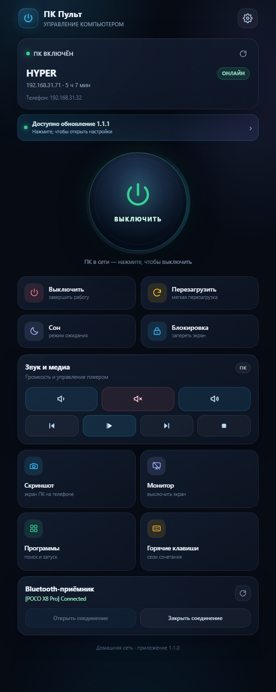
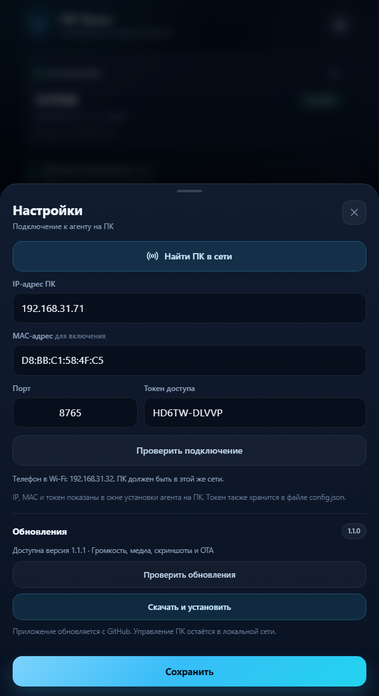
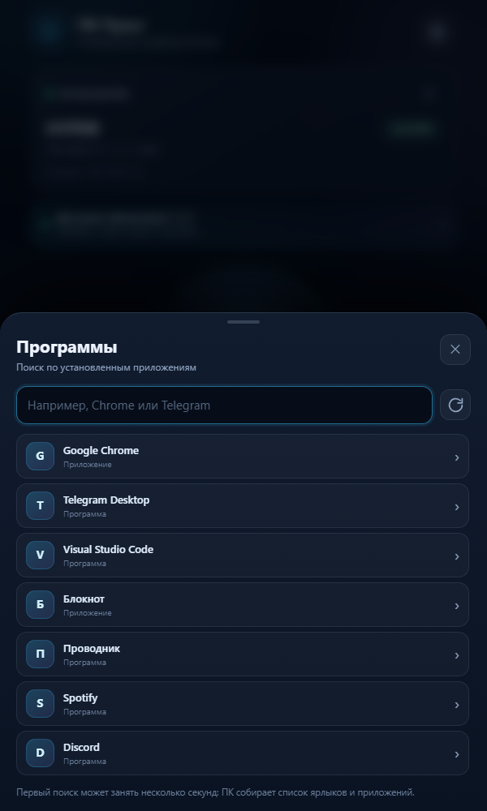
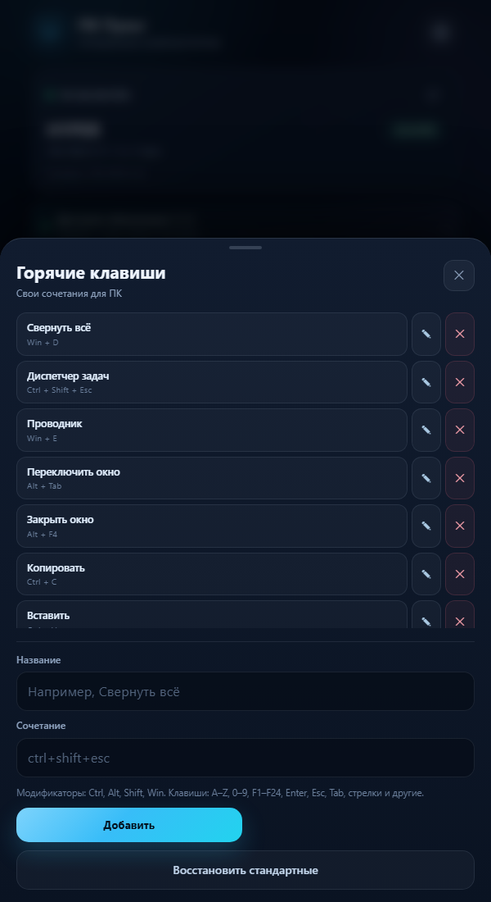
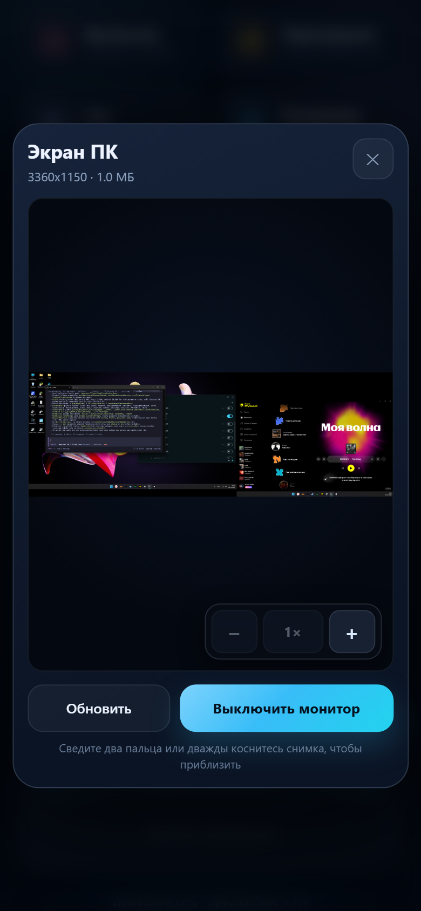

# ПК Пульт

Управление домашним ПК с Android-телефона по Wi-Fi. Включение по Wake-on-LAN, выключение, перезагрузка, сон, блокировка экрана, громкость, медиа-клавиши, скриншоты, запуск программ, горячие клавиши и Bluetooth-приёмник.

- **Телефон** — Android 7.0+ (APK).
- **ПК** — Windows 10/11, подключён кабелем к роутеру.
- **Связь** — команды идут только по локальной сети. Интернет нужен только для проверки OTA-обновлений с GitHub.
- **Сторонние библиотеки на ПК не нужны** — Python 3 и стандартные средства Windows.

## Возможности

| Раздел | Что умеет |
| --- | --- |
| Питание | Wake-on-LAN, выключение, перезагрузка, сон, блокировка |
| Звук | Громче, тише, выключение звука |
| Медиа | Предыдущий трек, пауза/воспроизведение, следующий, стоп |
| Экран | Снимок экрана ПК на телефоне, выключение и включение монитора. Кнопка сама меняется на «Включить монитор», когда экран погас |
| Программы | Поиск по ярлыкам и приложениям Windows, запуск в один тап |
| Горячие клавиши | Готовые сочетания и свои, с сохранением на телефоне |
| Bluetooth | Открыть и закрыть соединение в приложении «Bluetooth Audio Receiver» |
| Обновления | OTA: проверка GitHub, скачивание APK и установка поверх старой версии |

## Скриншоты

| Главный экран | Настройки и OTA |
| --- | --- |
|  |  |

| Программы | Горячие клавиши | Скриншот ПК |
| --- | --- | --- |
|  |  |  |

## Что в папке

```
pc-remote/
├─ PcRemote.apk          приложение для Android
├─ PcRemote.zip          готовый архив для передачи на другой ПК
├─ version.json          версия для OTA-проверки
├─ pc-agent/             агент и помощник для ПК
│  ├─ setup.cmd          установка (от администратора)
│  ├─ remove-agent.cmd   удаление
│  ├─ agent-info.ps1     показать IP, MAC, токен и состояние
│  ├─ pc_agent.py        агент: сеть, питание, прокси команд
│  ├─ session_helper.py  помощник в сессии пользователя
│  └─ config.example.json
├─ android/              исходники приложения и сборка APK
├─ docs/                 скриншоты
└─ make-dist.ps1         сборка PcRemote.zip
```

## Шаг 1. Установить агент на ПК

1. Откройте папку `pc-agent`.
2. Запустите **`setup.cmd`** и подтвердите запрос администратора.
3. Дождитесь надписи **«ГОТОВО — агент установлен и работает»**.
4. Запишите данные из окна: **IP-адрес, MAC и токен**.

Что делает установка:

- создаёт задачу `PCRemoteAgent` — агент от имени SYSTEM, автозапуск при включении ПК;
- создаёт задачу `PCRemoteHelper` — помощник в сессии пользователя, автозапуск при входе в Windows;
- создаёт задачу `PCRemoteLock` — блокировка экрана в сессии пользователя;
- открывает в брандмауэре TCP-порт `8765` и UDP-порт `8766` **только для локальной подсети**;
- запускает агента и помощника, проверяет их ответ.

Помощник слушает только `127.0.0.1:8767` и нужен для действий, которые нельзя выполнить из системной сессии: громкость, медиа-клавиши, скриншоты, запуск программ, горячие клавиши и UI Automation. Если пользователь вышел из Windows, питание и блокировка работают, а мультимедиа и программы — нет.

Токен хранится в `pc-agent/config.json`. Посмотреть данные ещё раз можно через `agent-info.ps1`.
Удалить всё — `remove-agent.cmd` (тоже от администратора).

## Шаг 2. Установить приложение

1. Перекиньте `PcRemote.apk` на телефон (USB, облако, мессенджер).
2. Откройте файл и разрешите установку из этого источника.
3. Запустите **«ПК Пульт»**.

Для OTA-обновлений Android может попросить разрешение **«Установка неизвестных приложений»** для «ПК Пульт». Это разрешение используется только для APK, скачанного с GitHub-релиза проекта.

## Шаг 3. Подключить телефон к ПК

1. Подключите телефон к тому же Wi-Fi, что и ПК.
2. В приложении откройте настройки. Нажмите **«Найти ПК в сети»**.
3. Выберите компьютер — IP, MAC и порт подставятся сами.
4. Введите **токен** из окна установки агента.
5. Нажмите **«Проверить подключение»**, затем **«Сохранить»**.

Если поиск не сработал, введите IP, MAC, порт `8765` и токен вручную.

## Как пользоваться

### Питание

- **Большая кнопка** — если ПК в сети, выключает его; если нет, отправляет Wake-on-LAN и ждёт загрузки.
- **Выключить / Перезагрузить / Сон** — с подтверждением.
- **Блокировка** — сразу блокирует экран ПК.

### Звук и медиа

Кнопки `−`, `🔇`, `+` меняют громкость Windows. Медиа-кнопки работают с активным плеером: предыдущий трек, пауза/воспроизведение, следующий, стоп.

### Скриншот и монитор

- **Скриншот** — делает снимок экрана ПК и показывает его на телефоне. Снимок уменьшается до 1600 px по большей стороне, чтобы быстро передаваться по Wi-Fi.
- **Выключить монитор** — доступно на главном экране и прямо в окне снимка. Когда экран гаснет, та же кнопка показывает **Включить монитор**. Это работает и после автоматического отключения по таймауту схемы питания Windows (по умолчанию 15 минут бездействия).

### Программы

- **Программы** — поиск по ярлыкам из меню «Пуск» и по приложениям Windows.
- Начните вводить название, например `chrome`, `telegram` или `steam`.
- Нажмите на строку — программа запустится на ПК.
- Первый поиск может занять несколько секунд: ПК собирает каталог.

### Горячие клавиши

- **Горячие клавиши** — готовые сочетания и собственные.
- Формат: `ctrl+shift+esc`, `win+d`, `alt+f4`, `f24`.
- Модификаторы: `ctrl`, `alt`, `shift`, `win`.
- Клавиши: `A–Z`, `0–9`, `F1–F24`, `enter`, `esc`, `tab`, `space`, стрелки и другие.
- Список хранится на телефоне. Его можно изменить или восстановить стандартный.

### Bluetooth Audio Receiver

- Приложение **Bluetooth Audio Receiver** должно быть установлено на ПК из Microsoft Store.
- В нём выберите телефон, например `[POCO X8 Pro]`.
- В «ПК Пульт» появятся кнопки **«Открыть соединение»** и **«Закрыть соединение»**.
- Кнопка **«Проверить»** вручную запускает приложение в фоне, проверяет состояние и возвращает его в свёрнутое. Окно приёмника не выходит на передний план и не перекрывает другие программы.
- Автоматического опроса Bluetooth больше нет — проверка выполняется только по кнопке.
- Если приложение закрыто, команда открытия или проверки запустит его.

## OTA-обновления

Приложение проверяет обновления на GitHub при запуске (не чаще раза в 6 часов) и по кнопке **«Проверить обновления»** в настройках.

1. Если доступна новая версия, на главном экране появляется баннер.
2. Откройте настройки → **«Скачать и установить»**.
3. APK скачивается с GitHub-релиза и передаётся системному установщику Android.
4. Подтвердите установку поверх текущей версии.

Обновление подписано тем же ключом, что и установленное приложение, поэтому данные и настройки сохраняются. Для OTA нужен интернет на телефоне; управление ПК по-прежнему работает только в локальной сети.

Репозиторий и релизы: **https://github.com/NetlApps/pc-remote**

## Wake-on-LAN: плата и настройки BIOS

- Материнская плата: **MSI H510M-A PRO (MS-7D22)** (OEM-плата в ПК DEXP Mars E332), BIOS AMI **E7D22IDR.3D1** от 24.08.2021.
- Сетевая карта **Intel I219-V**, MAC `D8:BB:C1:58:4F:C5`.
- В драйвере включены **Wake on Magic Packet** и **Enable PME**, карта есть в списке устройств, будящих ПК (`powercfg /devicequery wake_armed`).
- **Быстрый запуск Windows отключён** — это важно для пробуждения из полностью выключенного состояния.
- IP ПК сейчас `192.168.31.71`.

### Что включить в BIOS (точный путь для MSI Click BIOS 5)

1. Перезагрузите ПК и нажмите **Delete** при появлении логотипа MSI. Если открылся упрощённый экран (EZ Mode), нажмите **F7**, чтобы перейти в Advanced Mode.
2. **SETTINGS → Advanced → Power Management Setup**:
   - **ErP Ready** → **Disabled**. При Enabled не работает пробуждение из S4/S5 по USB, PCI и PCIe.
   - Необязательно: **Restore after AC Power Loss** → **Power On**, если хотите, чтобы ПК сам включался после пропадания электричества.
3. **SETTINGS → Advanced → Wake Up Event Setup**:
   - **Wake Up Event By** → **BIOS**.
   - **Resume By PCI-E Device** → **Enabled**.
   - **Resume By Onboard Intel LAN** → **Enabled** (на этой плате LAN вынесен отдельным пунктом).
   - **Resume By USB Device** можно оставить **Disabled**.
4. Нажмите **F10** → **Yes**, чтобы сохранить и выйти.

Если ПК не включается по кнопке:

1. Проверьте пункты BIOS из раздела выше — чаще всего виноват включённый **ErP Ready**.
2. После выключения ПК проверьте, горит ли индикатор на сетевой карте/роутере.
3. Убедитесь, что в роутере выключена изоляция клиентов (AP isolation), а телефон не в «гостевой» сети.
4. IP ПК может измениться после перезагрузки роутера. Лучше закрепить его в роутере (DHCP reservation) или повторить поиск в приложении.

## Безопасность

- Агент принимает запросы **только из частных локальных сетей**.
- Каждая команда требует токен; без него — ответ `401`.
- После 10 неверных попыток за минуту IP временно блокируется.
- Помощник сессии принимает запросы **только с localhost** и требует секрет, производный от токена агента. Наружу порт `8767` не открывается.
- OTA-проверка и скачивание идут по HTTPS с GitHub. Токен агента при этом не отправляется.
- Наружу не открывается удалённый доступ к рабочему столу и не передаются файлы.
- Если токен нужно сменить: измените `token` в `config.json`, перезапустите задачи `PCRemoteAgent` и `PCRemoteHelper`, затем обновите токен в приложении.

## Проверка и диагностика

На ПК:

```powershell
powershell -ExecutionPolicy Bypass -File .\pc-agent\agent-info.ps1
```

Скрипт покажет IP, MAC, токен, состояние задач, ответ агента и помощника.

Журналы:

- `pc-agent/pc_agent.log` — сетевые команды и прокси;
- `pc-agent/session_helper.log` — громкость, медиа, скриншоты, программы, Bluetooth.

Типичные ошибки:

| Сообщение | Что проверить |
| --- | --- |
| ПК не отвечает | Агент запущен? IP верный? Телефон в той же Wi-Fi? |
| Неверный токен | Скопируйте токен из `config.json` или окна установки |
| ПК не найден | Брандмауэр, UDP 8766, изоляция клиентов на роутере |
| Не включается | Wake-on-LAN в BIOS, индикатор сетевой карты, DHCP-адрес |
| Не блокируется экран | Пользователь должен быть в системе; задача `PCRemoteLock` |
| Помощник сессии не запущен | Войдите в Windows; проверьте задачу `PCRemoteHelper` и `session_helper.log` |
| Нет звука/медиа/скриншота | Задача `PCRemoteHelper` работает? Пользователь в интерактивной сессии? |
| Bluetooth-кнопка недоступна | Откройте «Bluetooth Audio Receiver» на ПК и выберите телефон в списке |
| Не скачивается обновление | Интернет на телефоне, доступ к GitHub, разрешение на установку APK |
| ПК не отвечает при включённом VPN | См. раздел «Если на ПК включён VPN (WG Tunnel)» ниже |

Быстрая проверка с ПК:

```powershell
$cfg = Get-Content .\pc-agent\config.json -Raw | ConvertFrom-Json
Invoke-RestMethod "http://127.0.0.1:8765/status" -Headers @{ 'X-Auth-Token' = $cfg.token } | ConvertTo-Json -Depth 4
```

## Если на ПК включён VPN (WG Tunnel)

WG Tunnel 2.4.x при поднятом туннеле блокирует весь трафик локальной сети
через WFP — даже когда «Kill switch» выключен. Встроенная опция «Allow LAN
traffic» в этой версии не работает: демон падает при разборе списка сетей
(`parse allowed networks ... no '/'`). Телефон не достучится до агента, даже
если брандмауэр Windows разрешает порт 8765.

Установщик ставит фоновый сторож `PCRemoteLanGuard` — задачу SYSTEM, которая
запускается при старте системы. Он раз в 2 секунды проверяет WFP-подслойку
WG Tunnel и удаляет только два фильтра: `WGTunnel-Block inbound all (IPv4)` и
`WGTunnel-Block outbound all (IPv4)`. Разрешающие фильтры WG Tunnel (туннель,
loopback, DHCP, служба) и IPv6-фильтры не изменяются. Сам туннель и служба
WG Tunnel не перезапускаются.

Если в WG Tunnel включён kill switch, сторож приостанавливается, чтобы не
ослаблять защиту; в этом режиме LAN снова блокируется.

Проверить состояние и журнал:

```powershell
Get-ScheduledTask -TaskName PCRemoteLanGuard | Select-Object TaskName, State
Get-Content .\pc-agent\lan_guard.log -Tail 20
```

Остановить или удалить сторож:

```powershell
Stop-ScheduledTask -TaskName PCRemoteLanGuard
Unregister-ScheduledTask -TaskName PCRemoteLanGuard -Confirm:$false
```

Сторож нужен только при включённом WG Tunnel в режиме VPN. Если WG Tunnel
обновится и переименует свои фильтры, сторож перестанет что-либо удалять —
LAN снова закроется, и скрипт нужно будет обновить.

Установщик и эти команды нужно запускать от имени администратора.

## Пересборка APK и релиз

Исходники лежат в `android/`. Нужны JDK 17 и Android SDK (build-tools с `aapt2`, `d8`, `apksigner`).

```powershell
$env:JAVA_HOME = 'C:\путь\к\jdk-17'
$env:ANDROID_HOME = 'C:\путь\к\android-sdk'
cd android
powershell -ExecutionPolicy Bypass -File .\build-apk.ps1
```

Готовый файл появится в корне как `PcRemote.apk`. Сборка проверяет, что `version.json` совпадает с `AndroidManifest.xml`.

Ключ подписи — `android/keystore/pcremote.jks` (пароль `pcremote`). Он **не публикуется в репозитории**. Храните ключ отдельно: с другим ключом OTA-обновление поверх установленного приложения не встанет.

Сборка автоматически нормализует пути внутри APK через `fix-apk-names.py`: `aapt2` на Windows иногда записывает в заголовки обратные слеши, из-за чего Android не находит встроенные файлы интерфейса. Интерфейс загружается через внутренний адрес `https://appassets.local` и `shouldInterceptRequest`.

Полный архив для передачи:

```powershell
powershell -ExecutionPolicy Bypass -File .\make-dist.ps1
```

Для нового релиза:

1. Поднимите `versionCode` и `versionName` в `android/AndroidManifest.xml`.
2. Обновите `version.json` (версия и заметки к релизу).
3. Соберите APK и архив.
4. Создайте GitHub-релиз с тегом `vX.Y.Z` и приложите `PcRemote.apk`, `PcRemote.zip`, `version.json`.

```powershell
gh release create v1.1.0 .\PcRemote.apk .\PcRemote.zip .\version.json `
  --repo NetlApps/pc-remote --title "ПК Пульт 1.1.0" --notes "Новые возможности"
```

## Что проверено

- Установка на реальный телефон **Xiaomi 2511FPC34G (HyperOS 3, Android 16)**.
- Поиск ПК по UDP, сохранение настроек, проверка токена и статус **«Онлайн»**.
- Агент и помощник сессии работают как задачи Windows; IP определяется по LAN-адаптеру даже при включённом VPN.
- Громкость, горячие клавиши, каталог программ, скриншот и ручная проверка Bluetooth-приёмника проверены через агент.
- Bluetooth 1.1.3: кнопка **«Проверить»** запускает приёмник в фоне, не перекрывает окна и возвращает его в свёрнутое состояние; автоопроса нет.
- Реальный цикл: выключение ПК из приложения и последующее включение по **Wake-on-LAN**.
- BIOS настроен: `ErP Ready = Disabled`, `Resume By PCI-E Device = Enabled`, `Resume By Onboard Intel LAN = Enabled`.

## Ограничения

- Помощник работает только при входе пользователя в Windows. После выхода из системы доступны только питание, статус и блокировка.
- Запуск программ и UI Automation зависят от прав пользователя и настроек Windows.
- Для Bluetooth-приёмника нужно установленное приложение Microsoft Store и выбранный телефон в его списке.
- Для пробуждения из полностью выключенного состояния нужны настройки BIOS из раздела выше и дежурное питание сетевой карты.
- iPhone не поддерживается этим APK — для iOS нужно отдельное приложение.
